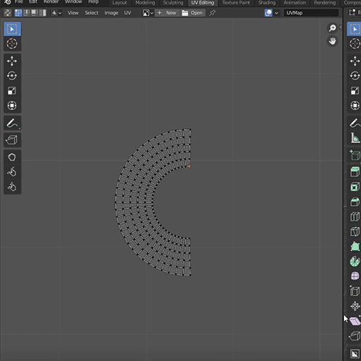
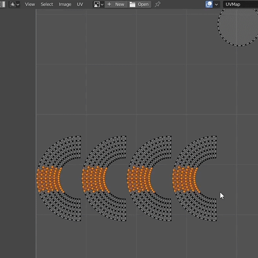

# SweetRoll UV Unroller (Blender Addon)
Helping Old Lady Palmer one UV island at a time

Do you strongly dislike straightening your rolled-up uv islands in blender? Are you tired of having to use follow active quads to re-unwrap your curved uv islands to attempt to straighten them out? Well now you will never manually straighten your curved uvs again with SweetRoll™!!!

Just select a vertex in the UV editor, right-click and select "Sweet (Un)roll" and your semi-circular uv strip will be straight in the blink of an eye!

Version 3.0.0
Works with Blender 3.x, 4.x and 5.x (tested on 4.4, 4.5 and 5.2)

## Installation

Download the zip file in the blender plugin directory
Install the addon in Blender by going to Preferences > Add-ons > Install from Disk (the dropdown arrow in the top right; just Install in Blender 4.1 and older) and choosing the sweetroll zip file

## Usage

Select 1 or more uvs on the uv island(s) you want to unroll. Right click and select Sweet(un)roll

You can also select many islands at once.

## Options

After you run it, open the Sweet (Un)roll panel in the bottom left corner of the UV editor (or press F9) to change how the island is straightened.

| Option | What it does |
| --- | --- |
| Spacing | **Average** uses the average length of the uv edges in each row and column. **Border** uses the uv edges along the first row and column. **Mesh** uses the edge lengths of the mesh itself, so the texture is not stretched. **Even** makes every row and column the same size. |
| Orientation | **Vertical** or **Horizontal** points the long side of the island that way. **Closest** keeps it as close as it can to how the island sits now. |
| Placement | **Keep in Place** leaves the selected uvs where they are and straightens the island around them. **Fit to Bounds** scales the island to fill the 0-1 uv square. |
| Other Faces | What to do with faces that are not part of the grid of quads (triangles, ngons and poles). They are unwrapped around the straightened grid with the method you pick, or choose **Skip Island** to leave islands like that alone. |
| Selected Faces Only | Only straighten the quads that are fully selected, and unwrap the rest of the island around them. |
| Mark Seams at Cuts | Mark a seam where a closed loop had to be cut open. |

## Notes
- Islands do not have to be all quads. The grid of quads is straightened and any other faces are unwrapped around it
- Closed loops (rings, tubes) are cut open. The cut goes through the uv you selected, or along a line of seams if there is one
- Unwrapping the other faces uses Blender's Unwrap, so Blender will remember the method you picked there as its unwrap method
